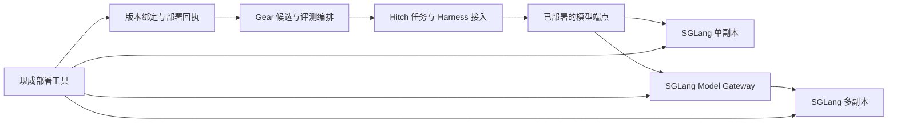

# 模型端点接入与普通推理运行时简化规范

- 状态：软件检查、Vast 推理拓扑短验收及静态分卡下真实训练/HF 导出/单任务 Harbor 端点评测诊断已完成；完整本机制品全闭包与离线 finite 复核已通过（108 个对象、35,467,670,234 字节），精确租机销毁已确认。诊断不构成正式 runtime 认证或完整 benchmark。作为 Hitch PR 51 与 Gear PR 64 的调整依据。
- 日期：2026-10-15。
- 适用范围：Hitch 普通模型调用、独立评测，以及 Gear 的模型候选评测。
- 代码基线：[Hitch PR 51](https://github.com/rsi-gear/agent-hitch/pull/51) 的 `2a0b729c5d984955cc3365fb7094f540e1368b66`；[Gear PR 64](https://github.com/rsi-gear/gear/pull/64) 的 `db4582b189c991ac63ca51efae18389ab121fe44`。
- 本规范替代 2026-10-14 版普通推理接入与运行时退出建议。已有训练规范中的普通评测部署要求与本文冲突时，以本文为准；训练 rollout、模型产物及历史证据保持各自原有语义。

普通推理统一接入已经部署的模型 API。Hitch 管理任务，Gear 管理实验与候选评测，推理引擎和部署工具管理模型服务。优先复用上游组件及仓库已有接入能力，直接删除被替代的自研普通推理实现，并围绕新架构测试。

## 1 核心决定

1. 多个独立 run、eval 和 daemon 可以使用同一模型端点。任务不选推理 GPU，不创建模型副本，不拥有模型服务的生命周期。
2. 默认部署方案为 SGLang；多副本时优先使用 SGLang Model Gateway 的独立后继发布 SMG（本轮验证 1.12.0）。单副本可直接连接 SGLang。Hitch 的端点契约不绑定具体引擎品牌。
3. 首版使用独立推理 GPU，与训练 GPU 静态分开。动态共卡不属于首版交付要求。
4. Hitch 不再维护普通推理的 Python 运行时、部署 API、GPU 账本、进程监督或副本调度器，也不将这些实现改写为 TypeScript。
5. `packages/inference/python/hitch_inference/` 全部退出。被替代的代码、包配置、启动器、fixture 和内部测试可以直接删除，无需为了未发布接口维护长期兼容层。
6. Responses 只需支持当前 Harness 实际使用的功能。1、2 等极小 token 预算，以及上游固定少量 token 预留差异，不作为交付阻塞项；不为这些边界新增补偿层、协议转换服务或专门测试。
7. 新普通推理路径直接传递请求预算，不继承旧路径的 `+2` 补偿。正常业务预算下的生成、工具使用、流式结束和 usage 仍需通过验收。
8. 保留训练 rollout 的精确采集、policy lease、fencing、checkpoint/HF export 和训练资源管理。删除范围按实际依赖判断，不能按目录名把训练能力一起删除。

## 2 代码基线与目标边界

| 基线实现 | 目标行为 |
| --- | --- |
| Hitch 按 `inference_id` 与 `cache_scope_owner` 选取托管服务 | 按冻结的端点绑定调用服务；任务 ID 仅用于归因、授权与取消 |
| Gear evaluator 导入模型并执行 `local plan --gpu --pool-file` | 部署准备在 evaluator 外完成，evaluator 接收就绪绑定 |
| 自研 Python 负责路由、排队、设备租约、进程恢复 | 通用能力由上游 Gateway、部署工具及已有资源系统承担 |
| 评测完成后停止推理服务并等待 GPU 释放 | 评测完成只结束自身任务和请求，长期共享服务继续运行 |
| 推理锁同时绑定模型、采样、设备、节点和拓扑 | 分离模型身份、公共评测条件、本次端点绑定与部署诊断 |

代码依据：[Hitch 服务键](https://github.com/rsi-gear/agent-hitch/blob/2a0b729c5d984955cc3365fb7094f540e1368b66/src/control-plane/inference-manager.ts#L167)、[Gear 部署规划](https://github.com/rsi-gear/gear/blob/db4582b189c991ac63ca51efae18389ab121fe44/src/training/hitch.ts#L267)、[Gear 服务清理](https://github.com/rsi-gear/gear/blob/db4582b189c991ac63ca51efae18389ab121fe44/src/training/hitch.ts#L93)。

仅移除服务键中的任务 ID 不足以完成改造。旧路径的服务停止、采样参数约束和资源计量仍带有独占服务假设，必须一起调整。

## 3 复用组件与责任划分



| 所有者 | 职责 |
| --- | --- |
| Hitch | 端点解析、Harness 配置注入、任务并发、请求取消与期限、usage 与评测证据、任务执行环境 |
| Gear | baseline/candidate 选择、训练产物、部署准备阶段记录、实验预算、评测配对和晋升 |
| SGLang | 加载模型、TP、批处理、KV cache、生成及 API 实现 |
| SGLang Model Gateway | 副本路由、请求队列、限流、健康检查等已配置的服务能力 |
| 部署工具与资源所有者 | GPU 分配、模型挂载、服务启停与恢复，以及需要时的训练与推理资源互斥 |

首版提供固定版本的 Docker Compose 或 systemd 配置示例，选择与实际部署环境匹配的一种即可。已有 Kubernetes 或 Slurm 环境可复用，不为本次改造额外搭建通用调度平台。

官方 Gateway 已提供多副本路由、队列、限流、健康检查和关闭重试等能力。部署配置必须显式设置适当的并发与队列上限，不能假定默认值适合实验负载。[Gateway 文档](https://docs.sglang.io/docs/advanced_features/sgl_model_gateway)

LiteLLM 等外部协议转换服务仅在实际 Harness 接入存在必要缺口时评估；不是首版默认依赖。其 Responses 到 Chat Completions 转换已有现成实现，若需要转换，应优先复用并验证工具与流式行为，而不是在 Hitch 内自建。[LiteLLM 文档](https://docs.litellm.ai/docs/response_api#calling-non-responses-api-endpoints-responses-to-chatcompletions-bridge)

## 4 端点注册与冻结绑定

### 4.1 注册信息

复用现有模型目录的索引、持久化和校验工具，新增普通外部端点类型。不要通过伪造 `model_node` 或 `inference_id` 适配旧类型。

```json
{
  "schema_version": "1",
  "base_url": "https://inference.example.com/v1",
  "wire_model": "coder-candidate-001",
  "api": "responses",
  "auth": {
    "kind": "env",
    "name": "CODER_API_KEY"
  },
  "capabilities": {
    "streaming": true,
    "tool_calls": true,
    "parallel_tool_calls": false,
    "input_modalities": ["text"]
  }
}
```

- `base_url` 是 API 根地址，规范化末尾斜杠后追加 `responses` 或 `chat/completions`；保留已有路径前缀，不重复添加 `/v1`。
- `wire_model` 是上游接受的模型名。普通调用可以使用服务别名；严格候选评测必须使用固定版本绑定。
- `api` 为 `responses` 或 `chat-completions`，显式选择，不做协议自动探测或静默转换。
- `auth` 使用环境变量或现有 secret 引用；无认证服务可显式使用 `{"kind":"none"}`。凭据不进入公共任务包、日志或证据。
- `capabilities` 是接入声明。所选 Harness 的必需能力要经过验证，声明本身不代表验证通过。首版只承诺串行 function 工具调用，`parallel_tool_calls` 必须为 `false`；注册或冻结绑定声明 `true` 时启动前明确拒绝，不静默降级。
- 注册信息不包含 GPU UUID、TP/DP、副本数、PID、SSH Python 命令或设备租约。

### 4.2 CLI

端点接入复用现有 `models`、`run` 和 `eval` 命令结构：

```bash
hitch models connect --name coder --file ENDPOINT.json
hitch models inspect endpoint/coder --verify --json

hitch run --harness HARNESS --model endpoint/coder \
  --prompt "总结这个项目" --output json

hitch eval run --daemon --dataset DATASET --harness HARNESS \
  --model endpoint/coder --max-concurrent 16 --output json
```

`connect` 只保存连接信息，不下载权重或启动服务。`HARNESS` 与 `DATASET` 分别替换为实际受支持的 Harness ref 和数据集。

注册项具有不可变 revision。任务提交时解析别名，冻结端点配置、协议、wire model 和本次生成参数；后续修改别名只影响新任务。恢复任务使用原冻结绑定。物理 GPU 或副本变化不要求修改普通任务输入。

`inspect --verify` 验证可达性、认证、模型名及所需协议能力；工具与流式能力通过有限的实际请求验证。`/models` 可达不能证明加载了特定权重，也不能证明工具能力。

### 4.3 Harness 与远程执行

复用 `src/model-access/` 和现有 Harness adapter 的 provider 配置、转发、采集与 secret 机制。新增普通 external endpoint 分支，不复制 `training-external` 的 `/lease`、policy fencing 或精确训练 capture 要求。

需要 Responses 的 Harness 必须获得已验证的 Responses 端点。首版不承诺所有 Harness 均可接入；不兼容组合在启动前明确失败。

Worker 和 Harbor 容器优先直连可达端点。需要控制端转发时，复用现有 TS 通道，仅完成绑定、鉴权、转发与观测，不管理模型副本或服务生命周期。容器中的 `127.0.0.1` 不自动指向模型宿主机。

凭据在实际向上游发请求的进程中解析：直连由 Worker/容器取得 secret，转发由控制端取得。启动前检查缺失凭据；公共 work spec 不携带明文上游密钥。daemon 使用的凭据必须在其运行环境中可用。

## 5 请求语义与生命周期

### 5.1 多任务共享

1. 两个独立 run、两个独立 eval 或不同 daemon 可以同时使用同一已部署模型服务。
2. 任务开始不部署服务；任务完成、取消、超时和回收不调用服务 stop、drain、flush cache 或 GPU release。
3. 取消只撤销该任务的访问和未完成请求，不影响其他消费者。请求取消不等于物理 GPU 已释放。
4. Hitch daemon 重启不改变外部模型服务。恢复请求继续使用冻结绑定，不重新解析可变别名。
5. 上游不可用时返回明确错误，不自动启动引擎、切换 GPU 或回退云模型。
6. `max-concurrent` 表示 Agent/trial 并发数；生成请求队列和副本负载由上游管理，不能把任务数等同于 GPU 数。
7. 外部模型服务不占 Hitch 控制端的推理 GPU 配额。任务工具自身需要 GPU 时，仍按任务资源契约处理。

共享服务使用自身缓存策略。冷缓存、专用副本或严格性能隔离实验应预先准备专用端点，普通 eval 不自动创建独占推理池。

### 5.2 协议支持范围

首版支持文本输入、完整多轮历史、当前 Harness 使用的串行 function 工具调用与结果回传、SSE、usage、错误传播、任务期限和请求取消。并行工具调用尚未验证，首版不接受 `parallel_tool_calls=true`。工具验证必须包含“生成工具调用 → Harness 执行 → 回传结果 → 模型继续回答”的完整往返。

`previous_response_id`、后台 Responses、服务端会话恢复、内置联网工具及多模态输入不作为首版验收要求。普通请求默认携带完整历史；不能因上游声称 OpenAI 兼容就自动声明全部功能支持。

生成参数按请求传递，严格评测在执行计划中冻结参数，不用绑定 GPU 的服务锁约束所有客户端。复用标准 SDK 或已有 fetch 接入，不发布第二套专有模型客户端。

### 5.3 token 预算取舍

本次不处理 1、2 等极小输出预算，不要求为它们补测试或修复上游；也不为固定少量 token 预留差异阻塞交付。新路径不新增人为最小预算限制，不在 Hitch 中加减 token，不继承旧路径的 `+2` 或其他静默补偿。实际不支持的请求交由上游明确返回结果或错误。

SGLang 的 Responses 转换曾保留用于 BOS/EOS 的两 token 余量；删除这一逻辑的上游提案未合并。该行为属于本项目接受的已知接入差异，不要求为此引入 LiteLLM 或维护专门补丁。[相关提案与关闭说明](https://github.com/sgl-project/sglang/pull/26158#issuecomment-5520089268)

验收使用实际业务配置的正常预算，例如 1024 或 4096，并在所选模型上下文容量内测试。检查请求能正常完成、预算正确传递、没有明显超出上限的生成及工具链路失效；不要求生成满预算，也不要求跨引擎逐 token 一致。正常预算下的系统性错误或明显超限仍是缺陷。

### 5.4 usage 与重试

usage 按上游实际返回记录。复用已有采集器做字段归一化，并保留来源；不能因字段名称不同丢弃真实计量，也不能把缺失值补成 0 或估造 token 数。

首版不新增请求级自动重试。严格评测关闭 Harness/SDK/Gateway 的透明生成重试与跨模型 fallback；已有显式任务 attempt 继续记录。普通任务保留其已声明的重试策略，不增加隐藏层。已开始的流不得透明重放。

按上游实际 HTTP 状态与错误体分类错误，不要求所有 Gateway 使用相同队列错误码。显式重试若存在，应遵守可用的 `Retry-After` 和任务总期限。

## 6 模型身份与可比较评测

### 6.1 分离三类信息

| 信息 | 内容 | 处理方式 |
| --- | --- | --- |
| 被评对象 subject | 权重 digest、模型版本、Harness 身份 | baseline 与 candidate 可以具有不同权重身份 |
| 公共比较条件 condition | 数据集、verifier、采样、预算、协议、引擎与解析配置、tokenizer/template、缓存与隔离条件 | 按现有配对规则判断等价性 |
| 本次调用 binding | 端点引用与 revision、wire model、部署回执引用、私有连接配置 | 每次评测冻结，可因模型版本不同而不同 |

不得把候选专属端点 revision、模型名、部署回执或权重 digest 整体塞进公共 `condition`，否则 baseline 与 candidate 无法满足相同条件。也不能因此丢掉引擎、量化、解析器或缓存策略等实际影响比较的条件。

端点绑定影响请求冻结和恢复校验；公共条件与 subject 决定结果是否可复用。部署诊断中的 GPU UUID、PID、节点 boot generation 不作为普通调用或质量评测路由条件。性能实验需要的硬件、拓扑和负载条件另外冻结。

当前配对逻辑要求公共条件一致，修改时保持这一约束的含义。[Gear 配对校验](https://github.com/rsi-gear/gear/blob/db4582b189c991ac63ca51efae18389ab121fe44/src/training/evaluation.ts#L45)

### 6.2 普通调用与严格候选评测

普通端点允许模型内容身份未知，如实标记未验证。模型名回显或客户端自填 digest 不构成已加载该权重的证明。

Gear 严格候选评测必须取得可信部署流程的回执，至少绑定模型产物 digest、固定 wire model、部署引用、服务配置及回执来源。部署流程校验实际挂载的不可变 HF snapshot；Hitch/Gear 核对回执与待评候选一致。复用现有 CAS、模型 manifest 和流水线产物，不要求 SGLang 实现 Hitch 专有签名或管理 RPC。

同一次评测期间，wire model 不得原地换成其他权重；同一模型名的 Gateway 副本必须对应相同候选版本。部署层负责防止漂移。缺失或错配的回执不能生成有效候选评测证据。

新旧调用方式、采样或缓存条件改变后，重新判断 baseline 可复用性。条件不等价时建立新 baseline，不沿用历史独占池结果冒充新条件结果。

## 7 Gear 训练与评测衔接

### 7.1 按模型版本准备端点

`evaluation.inferencePool` 退出新评测契约。评测请求接收已就绪的模型端点绑定及候选身份，不接收 GPU UUID、TP 分组、副本或 boot attestation，不再调用 Hitch `local plan/prepare`。

端点按实际待评模型版本解析。实验不能只配置一个可变的“当前模型”端点，然后让 baseline 和所有 candidate 共用该别名。本次交付的部署输入是按不可变 HF snapshot digest 索引的外部 ready binding 文件映射。部署所有者使用已有部署工具准备这些产物；自动调用部署工具的适配器不在本次已实现范围内。

```text
选定 baseline 或 candidate 的不可变 HF snapshot
    → 查找该模型已有的有效部署绑定
    → 缺少时保存等待部署状态，由部署所有者补齐外部 ready binding
    → 校验回执、模型版本及协议就绪
    → 保存冻结绑定并提交 Hitch eval
    → 消费结果并进行比较
```

baseline 在训练前需要评测时也走相同准备逻辑。新 candidate 未部署就绪时记录等待状态，不使用旧模型代替。可以在同一共享 Gateway 上暴露不同的版本化模型名，也可以提供独立端点；不要求所有候选同时常驻显存。

### 7.2 复用现有编排与恢复

部署准备位于 evaluator 之外，复用 coordinator、事务与 journal。以模型产物及部署配置确定可重入的准备意图，持久化部署引用、绑定和就绪结果。崩溃后协调同一意图；评测重试不重复部署，也不偷偷创建新服务。

首版已实现外部文件映射：controller 的 `evaluationBindings.bindingsFile` 按 `model.hfSnapshotRef.digest` 查找 ready binding，`trustedReceiptSources` 限定回执来源。缺少映射或文件时保存 `endpointPreparations.status="waiting"` 并报告 `waiting-for-deployment`；补齐外部产物后继续同一运行。本次没有实现自动候选部署，不把等待人工或外部流水线准备标为自动化。无需新增常驻 Python worker、部署 daemon 或通用调度器。

候选部署不等于正式发布。评测准备不得调用 `HitchModelPublisher.activate()` 提前晋升候选。HF 导出、tokenizer/template 校验与不可变模型制品流程继续复用。

### 7.3 资源与取消

首版静态划分训练卡和推理卡，并在实际执行环境限制各自可访问的设备。共享模型服务由部署所有者管理，单个 eval 无权停止服务。

将现有 `resourcesReleased` 的混合含义拆开：evaluator 返回自身任务及请求是否结束，训练后端报告训练资源释放，部署/资源管理者报告推理资源释放。具体字段命名遵循仓库风格，但类型与状态机必须区分这三种事实。评测完成和暂停不能因为共享服务仍占 GPU 而一直等待，也不能将任务结束伪造成物理释放。

共卡模式仅在已有统一资源所有者管理训练与推理时启用；没有这样的系统时明确不支持，不影响首版静态分卡交付。仅设置不同的 `CUDA_VISIBLE_DEVICES` 或 Compose `device_ids` 不构成跨作业互斥。停止服务前由部署所有者确认相关消费者均已结束。[Compose 设备访问](https://docs.docker.com/compose/how-tos/gpu-support/)、[Kubernetes GPU 调度](https://kubernetes.io/docs/tasks/manage-gpus/scheduling-gpus/)

### 7.4 计量与预算

训练 GPU seconds 继续由训练后端计量。评测优先记录可归因的 token、请求次数和时间；共享服务的 GPU seconds 仅在部署侧提供可靠计量与分摊规则时记录。

新 evidence、取消返回值、usage 聚合与预算校验必须支持推理 GPU seconds 未知，并保留计量来源。未知不能记为 0，不能把池的全部 GPU 时间重复计入每个 eval。复用现有累计计量的去重与单调更新机制，不另建计费系统。

硬预算必须声明覆盖范围。只有训练计量时，可启用明确的训练 GPU 预算；要求覆盖训练与推理总 GPU seconds 的硬预算，缺少推理计量时应在配置阶段拒绝启用。不能悄悄缩小现有总预算含义。

## 8 直接删除与必须保留的代码

### 8.1 Hitch 删除范围

直接删除 `packages/inference/python/hitch_inference/` 的全部 28 个 Python 文件。其责任去向如下，不要求逐文件迁移或保留占位实现。

| 文件组 | 处理 |
| --- | --- |
| `gateway.py`、`http_server.py`、`http_transport.py`、`request_validation.py` | 使用上游协议与服务，删除自研普通 API 层及预算补偿 |
| `pool.py`、`pool_recovery.py`、`topology.py`、`plan.py` | 使用 Gateway 与部署配置，删除自研池调度 |
| `engine.py`、`launch.py`、`worker.py`、`process_service.py`、`process_identity.py`、`recovery.py`、`attach.py` | 使用上游启动入口和现成服务管理 |
| `device_lease.py`、`hardware.py`、`node_generation.py` | 推理资源归部署层，首版静态分卡 |
| `artifacts.py`、`content.py`、`snapshots.py`、`preparation.py`、`model_config.py` | 复用仍在使用的模型制品/CAS 与部署流程 |
| `runtime.py`、`observation.py`、`node.py`、`state.py`、`__init__.py` | 随普通推理运行时和专有节点 RPC 删除 |

同步删除 wheel/`pyproject.toml`、npm 打包 Python 的逻辑、Python bridge CLI、专有部署 SDK、模拟旧引擎的 fixtures，以及只服务旧运行时的测试。`packages/inference` 没有独立剩余职责时整体删除；普通 HTTP 接入归现有 `src/model-access/`。

新端点调用链完全绕开 `src/control-plane/inference-manager.ts` 与 `src/inference/supervisor.ts`。移除仅供普通托管推理使用的节点注册、RPC、SSH 启动、attach/recovery 和本机 Docker 模型托管入口；不保留默认启用的第二条普通推理管理路径。

`model-store`、manifest、CAS 和历史 schema 按调用关系保留仍被训练、制品或历史读取使用的部分。`remote-model-store`/`models add-node` 若依赖已删除 Python RPC，应清理其调用者，不能留下表面存在、实际不可用的入口。

### 8.2 Gear 删除范围

删除普通评测专用的 `inference_process.py`、`inference_attach.py`、`inference_recovery.py` 及节点 `inference.*` 分支，并清理其启动配置、测试与文档。移除 `hitch_inference` import、`deviceLeaseRuntime: standalone-v1` 运行依赖及独立 wheel 安装要求。

保留以下训练能力及其回归测试：

- `python/gear/training/inference/gateway.py` 中训练用 `ExactGateway`，以及 Slime rollout 对它的依赖。
- policy version、lease、fencing、精确 token/logprob/mask 采集与训练数据关联。
- 训练自身的 `runtime/device_lease.py`、job/recovery、checkpoint、HF export 与 CAS。
- Harbor、训练后端及其他任务工具实际需要的 Python 依赖。

删除普通推理包后，训练资源管理使用仍保留的训练实现；不能留下需要安装已删除 wheel 才能启动训练的分支。

### 8.3 删除与历史记录

可以在同一改造中替换调用者并删除旧实现，无需先维持两套长期可运行的架构，也无需让旧运行时内部测试继续通过。提交完成时，依赖、构建、安装和新调用链必须闭合。

历史锁与证据保持原摘要和解释；保留必要的读取能力，不为读取历史数据安装旧推理服务。旧任务不能静默改绑新端点后继续声称是原运行的恢复。需要重跑时创建关联历史记录的新任务。

试用环境若仍有旧服务运行，应在部署新版本前用旧版本工具停止并确认释放，再删除其运行环境。无需为此在新版本保留旧 daemon，也不能仅删账本便认为进程已经停止。

## 9 文件与接口调整范围

| 位置 | 调整要求 |
| --- | --- |
| Hitch `src/domain/inference.ts` 与 run/eval schema | 增加 external endpoint 类型、不可变绑定与对应证据；不强制普通端点提供完整推理锁 |
| Hitch `src/cli/commands/models.ts` | 新增 connect 与端点 inspect，复用现有持久化工具 |
| Hitch `src/model-access/`、Harness adapter | 复用注入、转发和采集，新增外部端点分支；去掉对普通端点的训练 lease 要求 |
| Hitch run/eval 执行链 | 绑定连接后执行任务，不 acquire/start/stop 模型服务 |
| Hitch inference manager、supervisor、节点及旧启动器 | 清除仅为已退出普通运行时提供服务的实现与导出 |
| Gear `src/training/hitch.ts` | 接收就绪绑定；删除模型导入、local plan、节点注册、服务 stop 和物理释放等待 |
| Gear `src/training/coordinator.ts` 与 journal | 在评测前准备对应模型绑定，保存并恢复准备意图，区分评测结束与资源释放 |
| Gear `types.ts`、`schema.ts`、`evaluation.ts`、`evaluation-usage.ts` | 新端点契约、subject/condition/binding 分离、未知计量和明确预算覆盖范围 |
| 两仓库的 guides、schemas、packaging、CI | 改为连接上游服务；删除普通推理 wheel 与旧专有 API 的安装和使用说明 |

## 10 按新架构测试

测试以新的用户行为和接口契约为准。删除的内部实现不再作为兼容目标；有价值的普通 API、流式、工具、取消和评测归因用例迁移到新端点测试中。受控 HTTP 测试端点只模拟标准协议与故障，不重建旧 Python 推理池。

### 10.1 软件契约

| 编号 | 场景 | 通过条件 |
| --- | --- | --- |
| A01 | 注册、修改别名与恢复 | 已提交任务保留冻结绑定，新任务取得新 revision；恢复不部署服务 |
| A02 | 两个独立 run 与两个独立 eval 共享端点 | 全部访问同一已部署服务；无引擎启动、GPU 选择或任务间设备冲突 |
| A03 | 取消一个任务及重启 daemon | 其他任务继续；没有模型 stop/drain/flush 调用；任务状态正确收敛 |
| A04 | 断线、429、超时、SSE 中断 | 错误与期限正确，不透明重放，不切模型，不自动部署 |
| A05 | 所选 Harness 的实际协议 | 正常业务预算下完成文本、多轮、SSE、工具完整往返及 usage 采集 |
| A06 | 本机、Harbor 容器、远程 Worker | 实际网络可达，凭据私有，缺失凭据启动前失败；按需覆盖直连与已有转发路径 |
| A07 | baseline 与 candidate 分别绑定 | 正确模型进入各自评测；缺失或错配部署回执被拒绝；候选专属绑定不破坏公共条件配对 |
| A08 | 部署准备与评测恢复 | 复用保存的部署意图和绑定，评测重试不重复部署；候选不会提前正式发布 |
| A09 | 共享资源与预算 | 任务结束不伪造 GPU 释放；未知计量不归零、不重复计费；总 GPU 硬预算缺少计量时拒绝启用 |
| A10 | 干净安装与依赖 | 普通客户端使用本身不依赖 Python 的测试 Harness 调通端点，无自研 Python 推理包、CUDA 或模型引擎安装要求 |
| A11 | 删除完整性与训练回归 | 无已删除包的运行依赖、失效导出或 CI 入口；历史证据仍可读；训练采集、资源管理与导出回归通过 |

A05 不包含极小 token 预算专项测试，不以少量 token 预留差异或生成长度未达到预算判失败。协议兼容矩阵只列实际承诺的 Harness 与功能，不要求 OpenAI 全量 API 一致。

### 10.2 上游集成与实机验收

固定引擎与 Gateway 版本或镜像 digest、模型 revision、tokenizer/template、工具解析器、Harness 版本和采样配置，保存部署示例与验收记录。不能使用浮动 `latest` 声称组合可复现。

至少验收：

1. 真实 SGLang 单副本，使用实际 Harness 完成含工具调用的任务。
2. TP=2 单副本，验证模型能正常生成及实际双卡执行。
3. TP=1 两副本，经官方 Gateway 承接并发任务，使用服务端指标确认请求分布；同时验证取消一个任务不影响其他消费者。
4. 静态分卡环境中，训练与独立评测使用各自设备，训练 rollout 和 HF 导出功能正常。

CPU 测试可证明任务和端点契约；实机记录证明引擎、拓扑和目标硬件组合。旧自研池的双卡记录不能代替官方 Gateway 新路径的验收。TP=2 两副本需要四卡证据，首版不以该场景为完成条件。

动态共卡、全部 Harness、服务端会话、多模态和极小预算均不列入首版必过清单。

### 10.3 当前实现与验收状态

本轮两仓库的软件实现、软件回归与包检查已通过。2026-10-15 在 Vast 单机 2×RTX 3090 上完成限定范围的真实引擎、双卡和双副本验证，并运行两个实际 Codex 工具任务，见[推理拓扑短验收报告](validation/external-inference-gpu-2026-10-15.md)。另一次固定 Slime 环境的实测将训练与普通推理静态分卡，完成一个任务、group=2、一次更新、原生 checkpoint/HF 导出及真实 Harbor 基线/candidate 端点评测配对，见[训练与端点评测诊断报告](validation/training-gpu-loop-2026-10-15.md)。后者明确 `validated:false`、runtime lock 为 `pending-gpu`，reward=0/0、loss=0、grad norm=0，不能声明学习提升或正式认证。完整本机制品全闭包与离线 finite 复核已通过（108 个对象、35,467,670,234 字节），精确租机销毁已确认；费用为创建至 absent 时长的 Vast 范围估算（Vast 计算与磁盘估算 $2.282704，含 $1 传输预留的保守 Vast 估算 $3.300331（< $5），不含既有跳板网络），非最终账单；Compose 容器、完整 Harbor benchmark 及第 10.2 节全部验收尚未完成。

| 范围 | 当前状态与证据边界 |
| --- | --- |
| 软件实现 | 已完成外部端点注册与冻结绑定、共享任务调用，以及 Gear 按 HF digest 的文件映射准备、等待/恢复、证据与预算契约；首版工具能力为串行 function 往返 |
| CPU / 受控 HTTP 回归 | 两仓库完整软件回归、保留的训练 Python 回归及后续针对性检查通过；真实 Gear→Hitch CLI 的 JSON/SSE 工具往返检查通过，使用受控端点，不代替真实引擎或 Harness 实机记录 |
| 构建、打包与干净安装 | 构建、类型/静态、架构/合同/文档与运行依赖闭合检查通过；npm/wheel 干净安装流程及无需 Python/CUDA 的已安装 Hitch 端点 canary 通过，安装通过不证明 GPU 部署可用 |
| 上游示例与 HTTP 工具 | 固定版本 SGLang/官方 Gateway 配置、TP=2 变体及正常预算验收工具的软件检查通过；配置解析、上游参数和受控协议检查不等于容器/GPU 验收 |
| 自动候选部署 | 未实现；已交付外部 ready binding 文件映射，缺失时持久化等待，部署由所有者或外部流水线完成 |
| SGLang TP=1 + 实际 Harness 工具任务 | 两个 TP=1 副本经 SMG 1.12.0 完成 Codex 0.145.0 求和工具任务；另以 SGLang 0.5.15.post1 / Qwen3.5-2B 单 TP=1 直连，通过严格 Hitch 就绪验证及真实 Harbor 基线/candidate canary，均 valid / reward=0 |
| SGLang TP=2 实际双卡执行 | PASS：真实 TP0/TP1、双卡负载、Responses/Chat 各 9 项 HTTP 检查及 Codex SHA-256 工具任务 |
| 官方 Gateway 两个 TP=1 副本的分布与取消隔离 | SMG 1.12.0 PASS：Responses/Chat 各 9 项，两 worker 请求正增量、取消隔离与实际 Codex 工具任务。旧 bundled sglang-router 0.3.2 的 Chat 通过，但 Responses named tool_choice 返回 400，不适用于该 Responses 配置 |
| 静态分卡下训练 rollout、独立评测与 HF 导出 | 有界诊断已完成：GPU 0 真实 rollout、一次更新及 native/HF 导出；GPU 1 普通服务在训练清理后保持原 PID 并成功响应。baseline/candidate 严格评测及配对通过，meanDelta=0。`validated:false` / `pending-gpu`；完整本机制品全闭包与离线 finite 复核已通过（108 个对象、35,467,670,234 字节），精确租机销毁已确认 |
| 真实 Harbor canary | 一个冻结任务的真实工具/任务/verifier 链路已执行；基线和 candidate 评测均 valid、reward=0，配对 inferenceErrorRate=0。任务执行为本机 Harbor / Docker，模型节点在远端 |
| 完整真实 Harbor benchmark | **NOT RUN：单任务流程诊断不代表整套 benchmark、held-out 质量或正式运行时认证；远程 Harbor worker 未验收** |

具体绑定文件和检查入口见[独立评测端点说明](training/standalone-inference.zh-CN.md)与[ready binding schema](schemas/ready-evaluation-endpoint-binding-v1.schema.json)。后续只按实际取得的记录更新对应状态；历史自研池证据不填补上述未运行项。实机发现 bundled Gateway 0.3.2 的协议类型拒绝标准 Responses 指定函数名请求；改用官方已发布 SMG 1.12.0 wheel 后同一严格探针及真实 Codex 任务通过。复用发布物，不增加自研协议转换层；示例独立固定 Gateway 版本，不能把 SGLang 引擎版本视为 Gateway 兼容性保证。

## 11 交付顺序与完成条件

1. 实现 Hitch 端点注册、冻结绑定、Harness 注入与共享调用，建立新路径的软件契约测试。
2. 提供并验证上游单副本及多副本部署配置，覆盖正常业务协议与实际 Harness。
3. 改造 Gear 的按模型部署准备、评测输入、证据配对、取消及预算契约。
4. 直接删除被替代的普通推理 Python 包及失效 TS、测试、打包与文档内容，修复剩余调用者；与前述步骤可在同一开发分支完成。
5. 运行与新代码相关的构建、类型、架构、安装、新路径集成和训练回归检查，完成承诺拓扑的实机验收。

完成后，普通推理和独立评测只依赖模型端点；通用推理服务能力由现成组件承担；跨任务共享、候选版本绑定及正常业务协议可用；已退出的自研 Python 普通推理运行时没有残留运行依赖；保留的训练链路通过回归。极小预算与少量 token 预留差异不阻塞交付。
