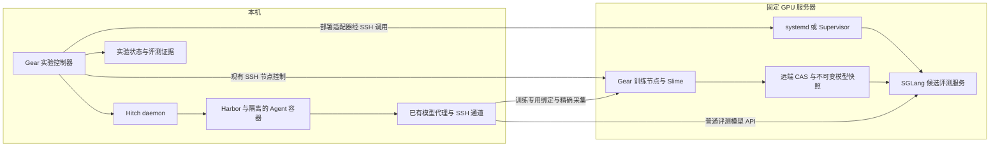

# Gear 与 Hitch 无人值守多轮训练和部署方案

日期：2026-10-15。状态：代码已实现并完成受控软件验证；真实 GPU、真实 Agent 容器及三种部署拓扑仍待后续验收。配置、CLI、恢复边界和验收交接见[无人值守迭代指南](training/unattended-iteration.zh-CN.md)与[受管原生部署](training/managed-native.zh-CN.md)。下文保留设计要求和原始基准，不把软件测试视为硬件验收。

目标是一次启动后，自动完成多轮“训练候选 → 部署候选 → Agent 评测 → 比较与选择 → 下一轮”，中间不手工启动模型、不填写端点映射、不逐轮执行 admit。本机和服务器两种执行位置都必须支持；实验和任务语义不随位置改变。当前优先落地本机 Gear、Hitch、Harbor 和 Agent Docker 环境连接远端固定 GPU 服务器的拓扑，GPU 模型节点不要求具备 Docker。

复用 Gear 的实验状态、训练后端与制品系统，Hitch 的任务执行与模型接入，SGLang 的推理服务，以及 systemd 或 Supervisor 的进程管理。新增工作集中在部署适配、持久化迭代控制和恢复衔接，不建设新的推理引擎、请求路由器或集群调度平台。

本方案的设计基于 Gear `c48f127f008559258cebac9cee3f51c8158e78bb` 和 Hitch `8a518e111881eef2848fa53d10ff23cab335cd2d`。它为原模型端点规范第 7 节增加自动部署与连续迭代的交付要求；原规范关于普通模型 API、不可变绑定、评测隔离和静态分卡的约束继续适用。正文保留设计中的语义示例；已实现接口、可解析 JSON 和 CLI 以文首两份操作指南为准。

## 1 已有实验基础与实际缺口

仓库已经存在用户描述的部署方案：

- [v2 controller 配置](training/controller-v2.zh-CN.md)采用本机控制端、`taskExecution.provider="local-docker"` 和通过 SSH 连接的 `modelRuntime.launcher="process"` 模型节点，支持 `artifactStorage="model-node"`。
- [2026-10-15 训练与评测诊断](validation/training-gpu-loop-2026-10-15.md)实际使用本机 Gear、Hitch、Harbor 0.21.0、Docker 与远端 GPU 节点。本机 Mac 的 Docker engine 为 aarch64，任务镜像为 amd64，该特定 canary 已执行成功。
- [双卡外部推理诊断](validation/external-inference-gpu-2026-10-15.md)覆盖了远端 SGLang、官方 SMG，以及本机工具任务通过 SSH 隧道调用模型的组合。

这些记录证明了部分执行链路；没有证明完整无人值守多轮迭代。训练诊断仍为 `validated:false`、`pending-gpu`，观测 reward、loss、grad norm 为 0；没有完成正式训练运行时认证、完整 held-out benchmark 或 optimizer 另进程恢复验收。此前服务启动和 ready binding 仍由部署操作者准备。原生进程曾在供应商预置镜像内运行，也不能据此声称任意裸机安装都已验证。

当前代码需要补齐四个直接缺口：

| 现有行为 | 本方案要求 |
| --- | --- |
| `ExternalFileEndpointPreparer` 缺少映射就等待 | 自动准备候选、启动服务、校验并生成 binding |
| `runTraining` 驱动一个 run，终态后返回 | 实验级控制器自动建立后续轮次 |
| 保存的 ready binding 直接复用 | 需要调用模型时重新确认部署实例和连接状态 |
| `evaluate` 先准备端点，再检查 baseline evidence | 先核验可复用证据，确实需要请求时才部署 |

## 2 支持的部署拓扑

“控制端”是运行 Gear 与 Hitch 的机器，可以是个人电脑或服务器；`local-docker` 表示 Docker 在该控制端，不表示一定在个人电脑。训练节点和普通推理节点分别配置本地进程或远端连接，训练与推理可以在同一 GPU 主机，也可以在不同主机。

| 必须支持的形态 | Gear 与 Hitch | Harbor 与 Agent 容器 | 训练与推理 |
| --- | --- | --- | --- |
| 本机控制与任务 | 本机 | 本机 Docker | 远端 GPU 主机原生进程 |
| 服务器控制与任务 | 常开服务器 | 该服务器 Docker | 另一台 GPU 主机原生进程 |
| 服务器一体部署 | 支持 Docker 的 Linux GPU 服务器 | 同机 Docker | 同机原生进程，静态划分 GPU |

三种形态复用同一个实验循环、部署合同和评测合同；改变主机、路径、连接和资源 profile，不复制业务实现。纯模型节点无 Docker 时使用前两种形态。没有任何可用 Docker 主机时，当前 Harbor 任务无法运行，不能用原生 SGLang 的可用性掩盖这一限制。

控制端仍在本机、但单独把任务发给远端 Harbor worker，是另一种控制端与任务端分离形态。它不是上述“服务器运行”的必要条件；现有 remote provider 有能力门禁和未验收项，不宣称本方案的整套迁移已自动解决这些问题。需要这种独立远端 worker 形态时，再补齐其专门合同和验收。

下图展示第一种形态：



本机负责 Agent 的工具、文件操作、依赖安装及评分；服务器负责模型计算。Agent 生成一条工具调用时，工具在本机任务容器内执行，结果再发送给远端模型，持续完成多轮交互。服务器不需要为了评测安装 Harbor 或启动 Agent 容器。

控制端必须保持运行、Docker 可用、网络可达。本机形态下，Mac 合盖休眠或本机断网会暂停进展；无人值守意味着不需要逐轮操作，不意味着本机离线后任务仍能运行。服务器形态下，个人电脑退出连接不会终止由服务管理器托管的控制器与任务。迁移活动实验时先暂停、复制并核验持久状态与制品、更新允许的连接配置，再显式恢复；不把运行中实验直接拷贝到另一台主机并同时启动。

## 3 职责与复用范围

| 组件 | 职责 | 生命周期边界 |
| --- | --- | --- |
| Gear 实验控制器 | 冻结实验输入、选择父模型、触发训练和部署、选择评测、比较候选、管理轮次与预算 | 拥有实验，不直接实现推理或容器调度 |
| Gear 训练节点与现有 Slime 后端 | rollout、更新权重、checkpoint、HF export、训练 GPU 管理 | 保留已有 policy lease、fencing 和精确 token/logprob 采集 |
| Gear 部署适配器 | 把模型快照和部署 profile 转为现成工具调用；记录部署意图、观察、就绪回执与释放 | 只管理显式归其所有的评测服务 |
| Hitch | 执行任务、注入冻结的模型绑定、管理任务并发与取消、采集轨迹、usage 和结果 | 任务结束不停止模型服务 |
| Harbor 与 Harness | 构建或准备任务环境、执行 Agent 和 verifier | 每个 trial 保持环境隔离 |
| SGLang | 模型加载、TP、生成、批处理和 KV cache | 以普通模型 API 对外服务 |
| 官方 SMG | 多副本时的路由、队列、限流与健康检查 | 单副本首版不需要引入 |
| systemd 或 Supervisor | 进程启动、状态、日志、停止及配置的重启行为 | 不决定候选质量、下一轮模型或实验预算 |

部署适配器是 Gear 调用的薄模块，不要求独立常驻部署 daemon。远端仅需要受约束的命令入口或短生命周期 helper，调用已有进程管理工具。Hitch 不恢复已删除的普通推理 Python runtime、设备账本和服务调度代码。

## 4 Agent 环境与模型连接

### 4.1 环境准备与隔离

首次准备固定 Harbor 版本、Harness 源码、任务镜像 digest、Agent 依赖和 verifier。共享基础镜像及下载缓存可以复用；正式评测不依赖人工进入容器后留下的未记录修改。

任务初始化步骤写入可重放的镜像构建或 Harness setup，并纳入环境身份。每个 trial 使用独立可写文件系统和任务工作区，结束后保留轨迹、评分及诊断，再回收其容器。基础环境配置在选定的本机或服务器上完成；持续在同一主机执行，不要求所有轮次共用一个有状态容器。

Apple Silicon 上需明确镜像架构和 Docker 资源限制。已有 amd64 canary 成功只覆盖该任务；真实任务集必须验证依赖、启动时间、工具行为和评分。模型 API 可用不能代替完整 Agent 环境验证。

### 4.2 普通评测与训练使用两条逻辑路径

普通候选评测采用冻结的 OpenAI 兼容 API binding。优先复用 Hitch 的宿主模型代理：Agent 容器访问该代理，远端模型经控制端受管 SSH 转发连接，同机模型直接连接宿主 SGLang。凭据由实际发出上游请求的宿主进程解析，不把上游密钥写入公共任务包。

训练 rollout 继续使用现有训练专用 binding、ExactGateway 和 policy fencing。不能因为候选评测改为共享 API，就把训练需要的精确 token/logprob 采集一并改成普通 Chat API。

普通评测隧道与训练隧道使用不同的记录、端口及所有权。提取并复用现有 OpenSSH 建连和身份核验逻辑；不得把候选端点塞进 `deployment.nodes.gpu.gateway`，该字段已有训练语义。隧道关闭只释放连接，不代表模型已停止。

容器内 `127.0.0.1` 不指向宿主。复用 Hitch 已有的容器可达代理入口，分别在 Mac Docker Desktop 与 Linux Docker 路径上从真实任务容器验证生成、工具回传及流式结束；不硬编码只有单一平台支持的宿主地址。SSH 断开后先修复同一目的地并校验实例；不重放已开始的生成请求。无法恢复原绑定时按显式评测修复处理。

## 5 远端原生部署与固定资源

SGLang 支持独立 Python 环境安装与启动，Docker 是可选安装方式。部署 profile 固定引擎版本、依赖锁、Python 入口和模型配置，不能在每轮中运行无版本约束的升级。训练和普通推理使用独立环境，避免更换普通服务依赖时改变训练 runtime lock。[SGLang 官方安装说明](https://docs.sglang.io/docs/get-started/install)

有可用 systemd 时使用 systemd 服务；没有 systemd、例如只提供普通进程环境的 GPU 实例，使用 Supervisor。systemd 的 control group 终止能力和 Supervisor 的进程组停止配置用于清理 TP 子进程；仅主 PID 退出不算释放完成。[systemd 进程终止文档](https://github.com/systemd/systemd/blob/main/man/systemd.kill.xml)、[Supervisor 配置](https://supervisord.org/configuration.html)

对候选评测服务，首版关闭无界的后台自动重启，由 Gear 记录有界恢复意图，再调用进程管理工具启动。进程管理仍由现成工具承担；Gear 负责决定是否还有预算、是否允许恢复以及恢复后的实例能否继续评测。常驻控制器可使用操作系统服务管理，但必须尊重持久化的暂停和停止意图。

首版预留互不重叠的训练 GPU 组和评测 GPU 组。训练只使用训练组；普通 SGLang 只使用评测组。设备可见性配置用于限制正常进程的选卡，不是跨用户强隔离，也不是抢占机制。主机资源所有者需预留这些 GPU，观察到外部占用就等待至期限或明确失败，不杀其他人的进程。

一个评测 GPU 组可只有一张卡，也可由 TP 副本使用多张卡。首版串行部署不同候选，不要求 baseline 和 candidate 同时常驻显存。GPU 组内同一模型服务可以接收多个并发 trial；任务并发不等于副本数量。

同一预留 GPU 组只由一个受管实验控制器持有部署修改权。首版不做多个实验之间的动态抢占、模型淘汰或自动扩缩容。公开长期服务使用另一组资源，或作为外部端点接入，不纳入实验自动回收。

## 6 三份配置与关键身份

配置分成三部分，避免把设备信息重新放回评测请求。

| 配置 | 内容 | 所在位置 |
| --- | --- | --- |
| 实验 spec | 模型、训练配方、数据划分、公共评测条件、选择策略、轮次与预算 | Gear 不可变实验输入 |
| deployment profile | 节点引用、原生进程后端、预留 GPU 组、TP、引擎环境、模型目录、启动与释放期限 | Gear 部署侧私有配置 |
| ready binding | 模型 API、协议、固定 wire model、能力、生成参数、认证引用与部署回执 | Gear 生成并冻结后交给 Hitch |

以下为新增配置的语义示例，不可直接提交给当前解析器；省略已有完整 spec 和 runtime lock 字段。

```yaml
iteration:
  maxRounds: 5
  maxWallClockSeconds: 28800
  maxConsecutiveRejected: 2
  onRejected: next-declared-proposal-or-stop
  onInconclusive: bounded-repair-or-stop
  autoPublish: false

endpointPreparation:
  mode: managed-native
  profileRef: gpu-evaluation-default

deploymentProfile:
  nodeRef: gpu
  backend: supervisor            # 有 systemd 的主机可选 systemd
  python: /opt/sglang-eval/bin/python
  runtimeLockRef: <verified-runtime-lock>
  resourceGroup: evaluation-gpus
  gpuUuids: [<reserved-gpu-uuid>]
  tensorParallelSize: 1
  maxResidentModels: 1
  startupTimeoutSeconds: 900
  stopTimeoutSeconds: 120
  maxDeploymentAttempts: 2
```

示例中的期限只是初始建议，需在实际模型冷启动后确定。它们与模型大小、磁盘速度和上下文配置一起冻结，不用短小模型的时间保证大模型启动。

准备意图由模型 HF snapshot digest、部署 profile digest 和部署所有者确定。实例另有独立 incarnation，防止一次重建被当成原实例。消费记录绑定实验、run、评测 attempt 和实例，不只保存一个易丢失的引用计数。

公共比较条件仍与具体模型绑定分离：引擎、解析器、量化、tokenizer/template、采样、数据与 verifier 等影响比较；候选 digest、端口、实例 ID、GPU UUID 不整体放入普通质量评测的公共条件。性能实验另行冻结硬件及负载。

## 7 部署适配器合同

在现有 `ModelEndpointPreparer` 抽象附近新增受管部署实现，并保留 external-file 模式用于已有服务。当前接口注释中的 “never deploy here” 及仅有 waiting/ready 的状态不足以描述自动部署，必须随新模式显式更新，不能只在原方法中偷偷启动进程。

建议提供四类操作，名称可按代码风格调整：

| 操作 | 输入与结果 |
| --- | --- |
| ensure | 接受持久化 intent，协调已有状态；返回准备中、就绪或有类型的失败 |
| observe | 核对实例身份、进程管理器状态、快照、连接及健康；不产生新服务 |
| acquireConsumer / releaseConsumer | 幂等登记消费者；提交评测前登记，确认任务及请求结束后释放 |
| retire | 拒绝新消费者，确认无人使用后停止自属实例并核对资源释放 |

执行顺序：

1. 在 Gear 事务中保存 intent、操作序号和期限，随后才执行远端副作用。
2. 检查远端现有实例与 intent 是否匹配。上一请求超时不等于失败，先观察再决定是否创建。
3. 在远端核对 HF manifest 和内容摘要，materialize 到按 digest 区分的不可变目录；与训练输出可写目录分离。
4. 校验固定资源组、依赖环境、端口与磁盘空间；等待可回收的旧实例退出。
5. 渲染固定参数并调用 systemd 或 Supervisor。服务名称和私有所有权记录包含 deployment identity。
6. 验证进程实例、实际模型路径、环境/参数摘要；等待真实模型请求成功。
7. 复用 Hitch 的能力探针，执行对应 Harness 所需的文本、SSE 和完整工具往返。完成身份与协议验证后才发布 ready binding。
8. 用同一 intent 将回执和 binding 原子持久化，重复 ensure 返回同一已确认实例。

回执由可信部署流程证明实际启动的是指定快照；`/models` 回显和健康检查不证明权重身份。原生方式应核验 snapshot 目录及文件、服务配置、真实运行进程的入口和参数，避免仅检查期望配置。公开回执复用现有允许字段；节点、PID、SSH 地址等诊断保留在私有部署记录，不硬塞入 `service_config`。

## 8 自动多轮状态与选择策略

实验外层状态为 `running / pausing / paused / completed / failed`，保存在现有实验存储中。单轮仍复用现有 coordinator，而非重写训练状态机。

机器或控制进程故障后的自动恢复由实验创建时声明的有界 recovery policy 授权，恢复仍使用更高的有序控制序号并确认旧资源退出。用户主动暂停必须持久化独立意图，不能因控制器自动重启而恢复训练或部署。

```text
核对初始环境与预算
  → 查询或建立 champion 的有效 baseline
  → 持久化 round 与训练请求
  → 训练并导出不可变 candidate
  → 校验 checkpoint 与 HF export 一致
  → 自动部署 candidate 并取得就绪绑定
  → 控制端 Hitch 执行 dev 评测
  → 按既有门槛决定是否消耗 held-out 预算
  → 原子提交 accepted / rejected / inconclusive
  → 释放本轮消费者并协调清理
  → 检查停止条件，建立下一轮或结束
```

外层新增 `roundIndex → runId` 的持久映射。下一轮 admission 与映射在同一事务中提交；恢复先检查已存在的 active run，避免在“admit 成功但返回前崩溃”后重复启动训练。每个实验只允许一个当前轮次。

接受候选时，新 champion 的权重、optimizer、scheduler/RNG 与数据 cursor 均来自该候选已提交的 checkpoint；下一轮正常续训，不只加载 HF 权重后从头初始化优化器。HF 快照服务于评测，native checkpoint 服务于训练恢复，两者不能互相替代。

拒绝候选时保留原 champion 及其 checkpoint。若已有声明并冻结的下一个训练 proposal，可从该 champion 继续尝试；不同 proposal 的数据选择、rollout 计划或可调整参数必须有来源和兼容性校验。没有新 proposal 时以 `no-new-proposal` 结束，不能把同一 optimizer/RNG/cursor 和同一输入反复执行冒充新探索。首版不引入自动调参系统；外层负责消费 Gear 已有或显式提供的候选计划，并记录计划身份。

`inconclusive` 或基础设施失败不当作模型质量差。只在明确预算内修复无效任务；用尽后结束或暂停，并保留原因。有效 reward=0 也是观察，不能为了获得更高结果重新跑。

停止条件至少包含总轮次、连续拒绝次数、训练预算、rollout token 预算、held-out 查询预算、总墙钟期限、数据耗尽及用户暂停。预先声明的目标分数或改进阈值可作为额外条件，不在运行过程中追着结果改门槛。候选被接受只更新实验 champion，不自动发布生产别名。

## 9 证据复用与单组 GPU 串行部署

先依据 subject 和公共 condition 查询完整有效证据，再准备端点。命中 baseline evidence 时不要求模型在线，也不申请评测 GPU；未命中才启动 baseline 服务。

一组评测 GPU 的典型时间线：

```text
部署 M0 → 得到 baseline evidence → 释放 M0 的评测消费者
训练产出 M1 → 回收无消费者的 M0 → 部署 M1 → 评测 M1
若接受 M1：其评测结果作为下一轮 baseline，训练从 M1 checkpoint 继续
训练产出 M2 → 回收无消费者的 M1 → 部署 M2 → 评测 M2
```

接受模型不代表它必须一直占显存。不可变快照、checkpoint 和有效评测证据持久保留；后续确有调用时可重新部署。同一证据复用不重复计费；新发生的部署和任务成本另记。

dev 用于候选选择，held-out 仅按既有声明策略和查询上限触发，不向训练 Agent 暴露 held-out 任务或逐题反馈。跨轮比较条件变化时重建 baseline，不直接复用旧条件结果。

## 10 服务共享与回收

区分两个明确的服务类别：

| 类别 | 共享与回收规则 |
| --- | --- |
| 外部长期端点 | 任意授权 Hitch 任务共享；Gear 不拥有其启停权 |
| 实验受管端点 | 同一不可变模型可供多个已登记消费者共享；所有消费者终止后允许自动回收 |

受管端点不作为无期限公共别名发布。所有会使用它的 Gear 评测或独立任务必须先向部署所有者登记消费，随后 Hitch 仍只收到普通冻结 binding。无法跟踪的外部使用者需要长期端点，不能将其混入自动回收服务。

回收采用 `ready → draining → stopping → released`。进入 draining 时在同一事务中关闭新消费者 admission；只有全部已登记任务/请求结束，才能停止服务。缺少心跳、控制器离线或一次查询超时均不能直接把使用者清零。恢复时依据持久记录与 Hitch 状态协调；身份未知则保留服务并报告阻塞。

停止限定到所有权和实例身份均匹配的服务组；等待 TP 子进程退出，并观察预留 GPU 上的自属计算进程消失。出现无关进程时报告资源冲突，不执行广泛 kill。任务完成、训练资源释放和推理资源释放使用三个不同状态。

版本名和绑定不能原地切换权重。新候选必须有新的实例身份与模型名；复用端口时必须轮换实例认证引用，使旧 binding 访问失败，不能误命中新模型。多副本时同一版本路由下所有 worker 必须对应同一快照。官方 SMG 可承担路由与队列；具体版本的模型路由、错误行为和配置必须通过协议探针，不能仅凭通用文档假设已支持。[SGLang Model Gateway 文档](https://docs.sglang.io/docs/advanced_features/sgl_model_gateway)

## 11 故障恢复与有界重试

| 场景 | 恢复行为 |
| --- | --- |
| SSH 启动请求超时 | 按原 intent 观察远端服务；确认没有实例后才重试 |
| 进程已启动但 ready 未落盘 | 核对实例和快照，重新验证后补齐同一准备记录 |
| 存储显示 ready，服务已退出 | ready 视为历史观察；先确认死亡并处理旧消费者，再决定恢复 |
| 模型加载失败或显存不足 | 有界失败；不静默修改量化、上下文、TP 或切换模型 |
| 本机断网或休眠 | 停止新 admission；沿用训练 contact/lease 期限和任务超时，不伪造清理完成 |
| Gear 重启 | 恢复运行意图、当前 round、服务及消费者；不重做已提交决策 |
| Hitch 重启 | 继续原冻结任务身份；Gear 查询真实任务终态后再回收服务 |
| SGLang 在评测中崩溃 | 在途任务记录明确错误，不透明重放；恢复后按显式 repair 处理 |
| 用户暂停与旧启动并发 | 持久化较新的停止序号，拒绝迟到启动，保持暂停后不再创建服务 |
| 停止超时或所有权不符 | 标记清理阻塞，保留诊断，不把 GPU 当作已释放 |
| 磁盘不足或快照不完整 | 在启动前失败，不把部分文件当成有效候选 |

部署实例变化后不能在原 eval journal 中替换 endpoint binding。若同一模型需要恢复评测，新增有界 attempt，冻结其新 binding，保留原 attempt 及已有有效 trial；只执行缺失/无效槽位。证据合并要求相同 subject、公共 condition 和任务身份，不把重新评测有效失败当成修复。

当前 Hitch/Gear 的 journal 会拒绝相同幂等 key 下请求摘要变化，因此必须设计“同一逻辑评测、多个显式部署 attempt”的记录关系，而不能简单重写 binding 文件。这是实施中的必要合同改动。若首版尚未支持跨实例 repair，必须明确结束该轮，不能假装已恢复。

首版单控制端、单本地持久目录，复用事务与互斥锁；不在 NFS 上假定本地锁具备分布式语义。远端副作用也要携带单调控制序号并在节点侧短锁内校验，避免客户端锁释放后旧 SSH 请求迟到生效。复用现有有序控制模式，不依赖“请求只执行一次”的假设。

## 12 制品存储与计量

模型与 checkpoint 默认留在远端 CAS，推理在同机 materialize，避免每轮将几十 GB 权重往返本机。控制端持有实验输入、不可变摘要、部署回执、评测轨迹和评分；训练制品通过已有 manifest 保持可定位、可验证。

至少保留初始模型、当前 champion 的完整 checkpoint/HF 闭包、活动候选和恢复所需制品。失败候选按明确保留策略清理；清理不能破坏仍被引用的 checkpoint 或已发布模型。所有完整传输必须经过 size 和 hash 校验才进入 CAS；中断文件保留为 partial。

远端存储是必需依赖。如果服务器临时租用，在销毁前完成 champion 和恢复必要制品的完整持久化；有元数据不代表权重已保全。复用已有 CAS 与传输工具，不新建模型注册中心。

预算分别记录训练 GPU seconds、rollout tokens、评测请求/token/耗时、部署次数、模型加载与驻留时长、总体墙钟时间。共享推理 GPU seconds 无可靠分摊时保持 null，不能填 0 或重复计入每个 eval。首版硬预算使用已有明确训练预算和部署/任务期限；全链路 GPU 硬预算需可靠计量才能启用。

实验墙钟期限跨重启保留。部署恢复、无效 trial 和失败训练仍消耗真实预算；重试不得刷新总期限。控制端长期离线时，仍需配置服务管理器或现成定时工具执行的自属服务最大运行期限，作为最终回收兜底；不在未知消费者存在时声称已优雅结束。期限触发的强制终止需记录失败证据，并与任务期限一致。

## 13 对 Gear 和 Hitch 的具体改动

| 位置 | 改动 |
| --- | --- |
| Gear `src/training/endpoint-binding.ts` | 保留 ready binding 校验和 external-file；新增受管原生部署实现或独立模块 |
| Gear `src/training/types.ts`、`schema.ts` | 定义准备中、失败、实例、消费与释放状态，扩展配置和版本校验 |
| Gear `src/training/coordinator.ts` | 先检查可复用 evidence；需要请求时 ensure；提交前登记消费，终态后释放；处理新部署 attempt |
| Gear `src/training/cli.ts` | 在单轮 run 外增加持久化实验循环、停止策略、状态展示与有序暂停/恢复 |
| Gear `src/training/store.ts` 及现有 journal | 原子保存轮次映射、意图、消费者、决策与清理记录 |
| Gear `src/training/transport.ts` 及节点入口 | 复用 SSH/身份/传输能力，增加有界部署命令及独立普通模型通道；保留训练语义 |
| Gear `src/training/hitch.ts` | 仍不部署模型；增加跨实例显式 attempt 的证据衔接，保留有效 trial 与累计成本 |
| Hitch `src/model-access/` 与 local-docker 接入 | 复用模型代理、冻结绑定、能力验证和取消；验证本机容器到远端模型路径 |
| Hitch 评测 attempt 合同 | 仅在现有接口不足时扩展新 attempt 与有效槽位保留；不新增模型服务管理 API |
| 文档与示例 | 更新端点 spec 第 7 节、controller-v2 指南；补原生服务模板、部署 profile 和三种部署形态的 Agent 示例 |

为新的持久化字段明确 schema 版本及迁移方式。已存在实验保持原输入与恢复语义，不自动把等待外部部署的实验切换为允许远端启动服务。新建自动模式实验时冻结部署与迭代策略。

## 14 实施顺序

1. **合同与单轮自动部署。** 更新自动部署要求，完成一种目标服务器可用的原生后端，打通导出、ensure、verify、binding、eval、释放。GPU 主机无 systemd 时优先交付 Supervisor，Docker Compose 不成为依赖。
2. **恢复与任务隔离。** 完成部署副作用幂等、实例重建、端口/凭据隔离、consumer drain、SSH 断线与有序取消；把已有手工诊断步骤变成受管调用。
3. **实验级多轮。** 完成轮次事务、checkpoint 连续性、拒绝/无新 proposal 分支、baseline 复用和所有预算停止条件。
4. **真实拓扑验收。** 分别在本机控制、服务器控制、服务器一体部署三种形态中运行实际 Agent 容器与原生模型服务，验证至少两轮无人工介入；同时完成必要的运行时认证，不绕过 pending-gpu 门禁。
5. **可选扩展。** 需求出现后再增加另一原生后端或 Compose；多副本复用官方 SMG。动态扩缩容、跨主机调度与抢占由后续独立项目承担。

## 15 验收标准

| 验收项 | 必须看到的证据 |
| --- | --- |
| 本机任务与远端模型 | 实际容器中的 Agent 完成模型生成、工具执行、结果回传和 verifier；模型计算发生在远端 |
| 服务器任务与远端模型 | Gear/Hitch/Agent 在常开服务器运行，连接另一 GPU 节点；个人电脑断开后实验继续 |
| 服务器一体部署 | 同一 Linux 服务器运行控制端、Agent Docker、训练和推理，资源隔离与任务路由正确 |
| 无 Docker GPU 服务器 | 服务器无需调用 Docker；选定原生环境启动 SGLang 与 TP 子进程并能完整停止 |
| 全自动部署 | 训练产生新的 HF digest 后自动形成部署回执与 ready binding，无人编辑映射 |
| 至少两轮自动执行 | 一次启动产生两个不同 round/run；第二轮无需人工 admit、部署或提交评测 |
| 接受后的训练连续性 | 新进程实际恢复候选的 optimizer、scheduler/RNG 和 cursor；与权重/checkpoint 摘要一致 |
| 拒绝与停止 | 拒绝不污染 champion；有声明的下一 proposal 时继续，无新 proposal 时有原因结束 |
| 基线复用 | 完整有效 baseline 命中时，模型不在线也不触发部署 |
| 正常训练语义 | 满足现有 runtime probes；保留真实非零学习信号的验证，不把零梯度 smoke 当作学习提升 |
| 比较有效性 | dev/held-out 分离，公共条件一致，查询预算不越界，真实质量结果照实报告 |
| 多任务共享 | 两个独立任务使用同一模型实例；取消其中一个后另一个继续完成 |
| 回收正确 | 活跃消费者存在时不停止服务；最后一个消费者结束后可回收；外部长驻端点不受影响 |
| 故障恢复 | 在启动前后、ready 落盘前后、eval 提交前后及决策提交处注入中断，不重复训练或部署 |
| 身份不串用 | 旧 binding 无法调用新候选；重建实例不会静默替换运行中评测绑定 |
| 有界退出 | 启动失败、断网、停止失败、预算耗尽都有有界结果及保留证据 |
| 完整制品 | champion 与训练恢复所需的制品闭包可验证，清理后仍可重建 |

软件测试使用受控进程和 HTTP 验证状态与故障边界；真实 GPU 验收验证原生环境、完整 Agent 路径、训练与模型加载。两者分别出报告。接受分支可先用确定性测试覆盖，实机不得降低门槛或伪造分数来强行制造晋升；实际没有候选达到门槛时，如实保留未验证的真实连续晋升范围。

完成本方案的标准是“Agent 可在本机或服务器持续执行、模型候选自动部署、实验自动推进且可恢复”，不是“存在一个模型 API”，也不是“人工补齐后可以继续”。
